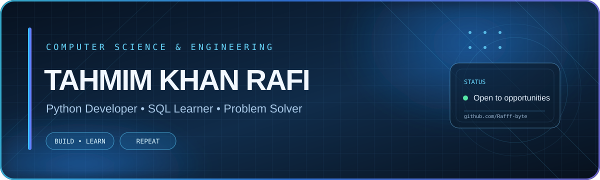

### `PYTHON` &nbsp; • &nbsp; `SQL` &nbsp; • &nbsp; `PROBLEM SOLVING`

---

<table>
<tr>
<td width="34%" valign="top">

# Tahmim Khan Rafi
**@Rafff-byte**

*Computer Science & Engineering Graduate*

📍 Dhaka, Bangladesh

### ✦ CURRENT FOCUS
- Building with **Python**
- Learning **SQL** and data
- Practicing clean code
- Improving problem-solving skills

### ✦ QUICK LINKS
- [Portfolio](#) <!-- Replace # with your portfolio URL -->
- [GitHub Repositories](https://github.com/Rafff-byte?tab=repositories)
- [LinkedIn](www.linkedin.com/in/tahmim-khan-raf

) <!-- Add your LinkedIn URL -->
- [Email](tahmimkhan1997@gmail.com <!-- Replace with your email -->

</td>
<td width="66%" valign="top">

## `01` — SYSTEM PROFILE

Just graduated with a degree in Computer Science & Engineering, and I’m excited to start building for real. I’m especially into Python,it's the language I’ve used most for projects, problem-solving, and just exploring how things work. I’ve also started getting hands-on with SQL and understanding how data fits into the bigger picture.
I’ve spent time working on small projects, writing clean code, and learning to break problems down step by step. I make up for what I might lack in years of experience with curiosity, consistency, and the drive to keep improving.
Right now, I’m looking for an opportunity where I can grow, contribute, and be around people who care about building good software. If you're working on something interesting, I’d love to be a part of it.

> **MISSION:** Keep learning. Build useful things. Improve every day.

</td>
</tr>
</table>

## `02` — TECH STACK / TOOLKIT

  

## `03` — FEATURED REPOSITORIES

> These are your currently visible public repositories. Replace or reorder them as you publish stronger projects.

## `04` — GITHUB ANALYTICS

## `05` — CONTRIBUTION SIGNAL

<!-- Contribution snake appears after you add the workflow file from this kit and push it to GitHub. -->

## `06` — CONNECT / ESTABLISH LINK

 

*“Curiosity drives the code. Consistency builds the craft.”*

